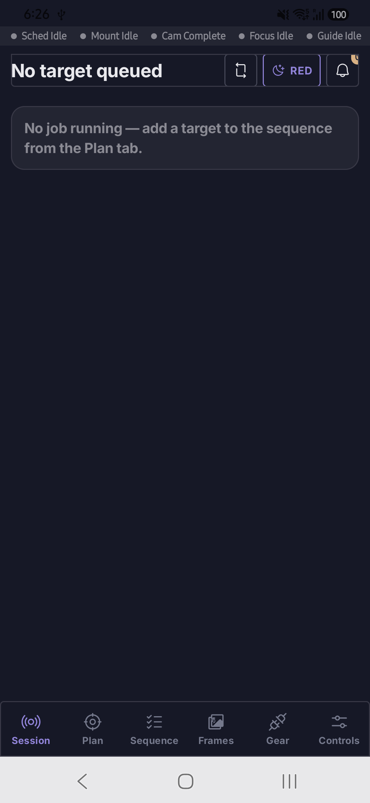
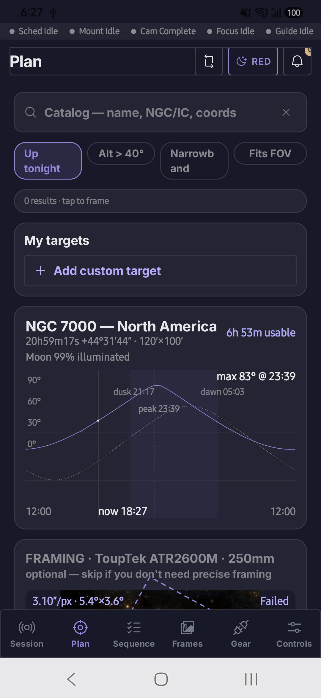
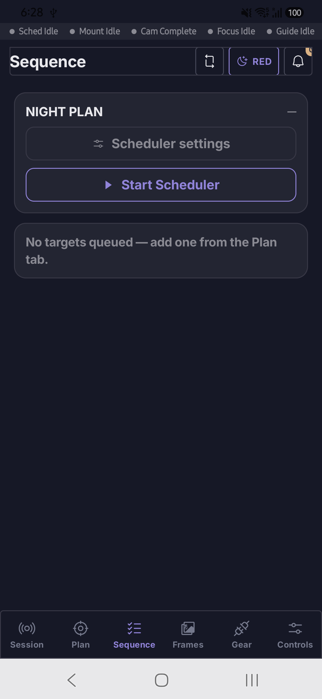
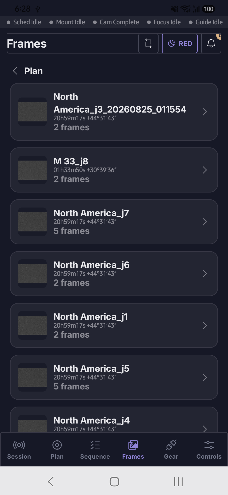
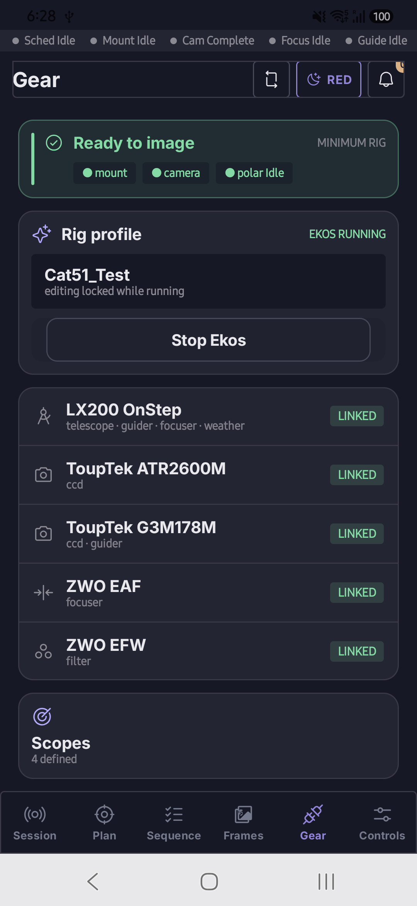
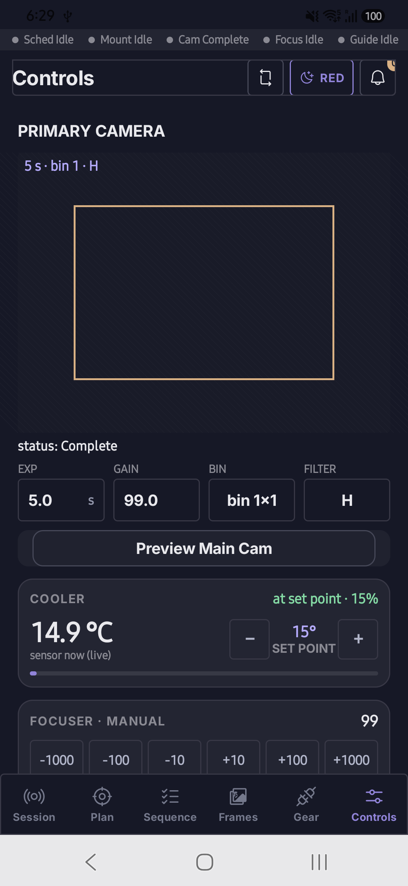

# Nocturne

Android app that runs an astrophotography rig from the field: target selection and framing,
capture sequences, guiding, focusing, polar alignment, frame review, alerts and a session summary.
It is the client for **EkosRemote**, a KStars fork: the Pi runs KStars + INDI + Ekos and listens on
the local network, and the phone connects directly. No cloud, no relay, no demo mode — it needs a
real rig.

Six tabs: **Session · Plan · Sequence · Frames · Gear · Controls**.

| Session | Plan | Sequence |
|---|---|---|
|  |  |  |
| Night arc, latest sub, HFR/RMS/SNR, module status | Target search, altitude chart with the Moon, framing, goto/center | Job queue, per-target sequences, Ekos Scheduler sync |

| Frames | Gear | Controls |
|---|---|---|
|  |  |  |
| Capture review, keep/cut, HFR across the run | Rig profiles, optical trains, devices | Camera, mount, guide, align, focus, polar alignment |

## Setup

- JDK 17, Android SDK Platform 35 (compileSdk/targetSdk 35, minSdk 26). The Gradle wrapper
  brings Gradle itself.
- `local.properties` with `sdk.dir` (Android Studio writes it on first sync).
- Optional, for the offline sky atlas inside the APK: a HiPS mirror at
  `~/astro-data/hips/DSSColor` (`pi-tools/hips-mirror`), or `-PnocturneAtlasDir=<dir>`. Without
  it the APK still builds, with no packaged atlas.

## Build and run

```bash
./gradlew :app:assembleDebug        # → app/build/outputs/apk/debug/app-debug.apk
./gradlew testDebugUnitTest         # unit tests (app/src/test)
./build_and_run_a24.sh              # build + install + launch on the USB phone (serial in run_a24.sh)
./build_and_run.sh                  # same on the Pixel_8 emulator (see docs/emulator-troubleshooting.md)
tools/push_sky_atlas.sh             # load sky-atlas order 5 (~900 MB) onto the phone over USB
```

Run adb outside any sandbox; a sandboxed adb server can't see USB devices.

## Connecting to the rig

Put the phone on the rig's network. The connect screen lists rigs it hears (UDP beacon, port
50505); or enter the Pi's address and port 9000. No authentication — trusted LAN only. The Pi side
(KStars fork, daemons) is described in `docs/FORK.md` and `pi-tools/*/README.md`.

## Docs

| Doc | What |
|---|---|
| `docs/STATUS.md` | What works, what's unverified, what's open |
| `docs/PROTOCOL.md` | EkosRemote wire protocol as the app uses it |
| `docs/FORK.md` | The KStars fork: changes, build/deploy, backlog |
| `docs/PLAN.md` | Draft future plan: rig status and logs, rig file manager, tab layout |
| `docs/emulator-troubleshooting.md` | Emulator gotchas |
| `pi-tools/*/README.md` | Pi-side tools |

`project/` holds the original HTML design prototype the UI was built from.
